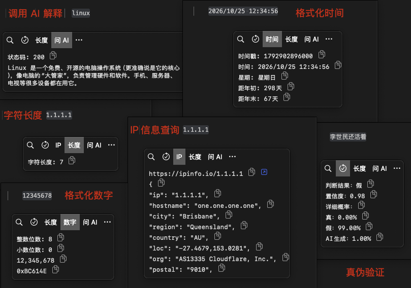

# Selecto

一个轻量但强大的 macOS 划词增强工具 / A powerful macOS text selection enhancement tool

Selecto 是一个使用 Swift 开发的 macOS 应用程序，当选中一段文本时，会在文本上方自动显示一个浮动工具栏，提供多种可自定义的功能。




#### 主要功能

- 🛠️ **浮动工具栏** - 自动检测文本选择，在选中文本上方显示优雅的浮动工具栏
- ⚙️ **高度可定制** - 通过设置界面配置各种动作和触发条件，比如执行 shell 脚本、打开链接等
- 🔍 **正则表达式支持** - 使用正则表达式匹配特定文本模式
- 🎨 **轻量** - 使用 SwiftUI 构建，体积非常小


#### 安装与使用

访问 [Releases 页面](https://github.com/echosoar/selecto/releases) 下载最新版本的 DMG 文件：

- **Universal (通用版)** - 支持 Apple Silicon (M1/M2/M3) 和 Intel 芯片
- **ARM64** - 仅支持 Apple Silicon (M1/M2/M3)
- **x86_64** - 仅支持 Intel 芯片

下载后双击 DMG 文件，将 Selecto.app 拖到 Applications 文件夹即可。


#### 从源码构建

```bash
# 克隆仓库
git clone https://github.com/echosoar/selecto.git
cd selecto

# 使用 Xcode 打开项目
open Selecto/Selecto.xcodeproj

# 或使用命令行构建
xcodebuild -project Selecto/Selecto.xcodeproj -scheme Selecto -configuration Release

# 运行
~/Library/Developer/Xcode/DerivedData/Selecto-*/Build/Products/Release/Selecto.app/Contents/MacOS/Selecto
```
